# 20 kW Residential Rooftop PV: Installation Programme (Primavera P6 and MS Project) and 3D Shading Study (OpenSolar and SketchUp)

Live on portfolio: **[usamajaved.ie](https://usamajaved.ie/roles/planning)**

Planning, layout and shading verification for a **20 kW on-grid residential PV system** in F-11/2, Islamabad: **36 LONGi 550 W modules** (`LR7-60HVH-550M`, **19.8 kWp**) on single-tilt frames at 20 deg, wired as two strings of 18 into one **Growatt MID 20KTL3-X** three-phase inverter.

---

## 1. Primavera P6 Installation Programme (`primavera-p6/`)

Built in Primavera P6 Professional 25.12 on a standalone database (`primavera-p6/20-kW-residential-pv-p6.xer`):
- **25 activities** under four WBS groups, from site survey to handover, joined by **31 relationships** on a Monday to Saturday calendar.
- Starting Mon 5 Oct 2026, P6 schedules the job to finish on **Mon 2 Nov 2026** (working day 25), with **17 activities on the critical path** and no date constraints anywhere in the logic.
- **Float and what-if analysis**: utility approval takes 14 days but carries 2 days of float, so the mounting steel fabrication drives the job. Cables have 9 days of float, modules 7 and the inverter 5. Stretching inverter delivery from 6 days to 13 moves the finish by only **2 days** (to Wed 4 Nov), while shifting the critical path off the mounting steel onto the inverter chain.
- The start date is an example and the durations are planning estimates.

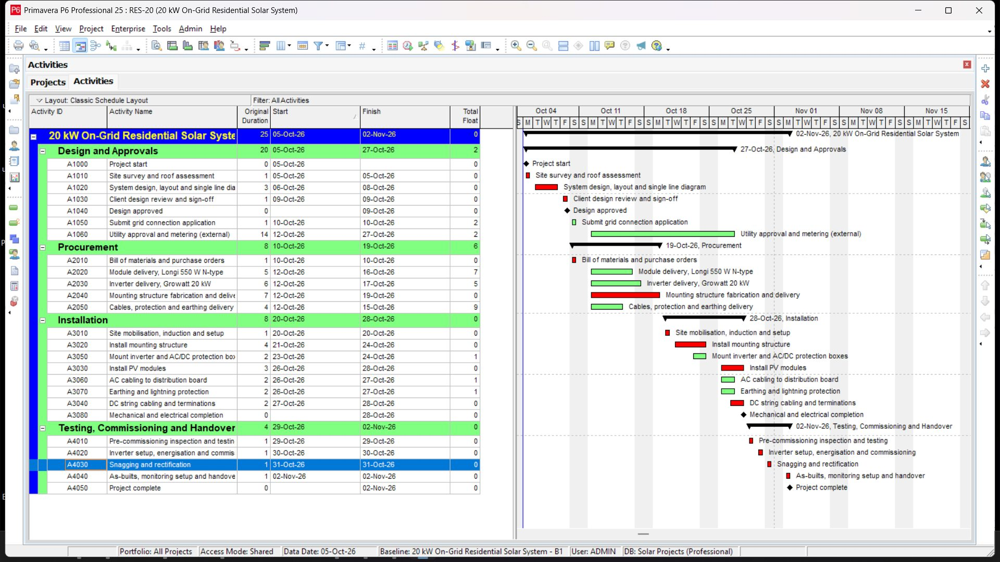
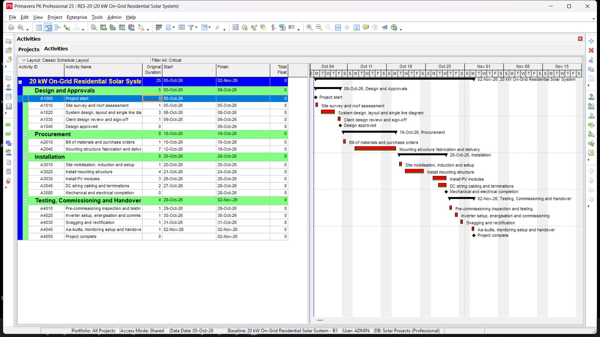
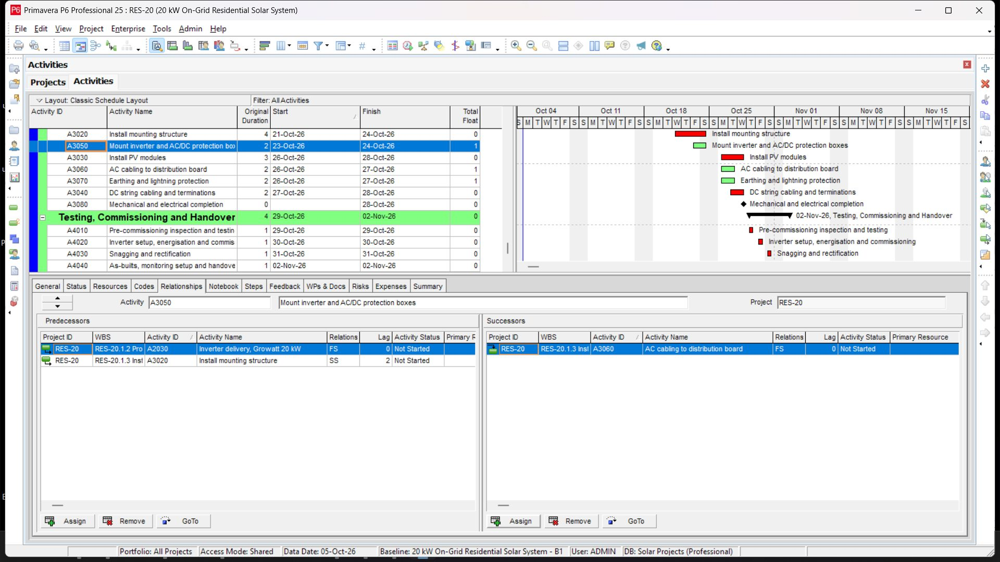
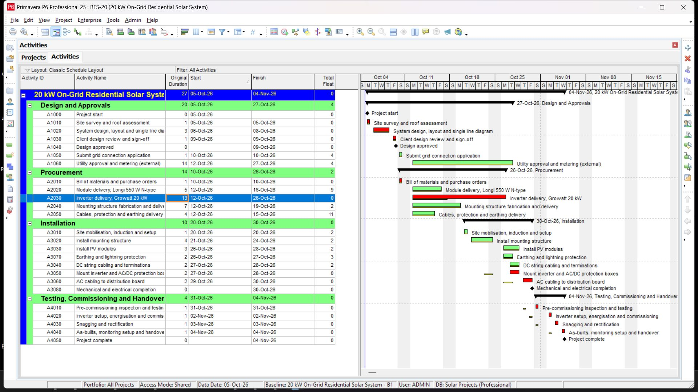

---

## 2. Microsoft Project Programme (`ms-project/`)

The same 20 kW residential programme built in Microsoft Project (`ms-project/20-kW-residential-pv-ms-project.mpp`):
- 25 activities under 4 summary tasks on a Monday to Saturday calendar, with finish-to-start links and two start-to-start links with lags.
- Handover finishes on working day 25 (Mon 2 Nov 2026), matching P6, with a saved baseline and 0 days of finish variance in the Tracking Gantt.

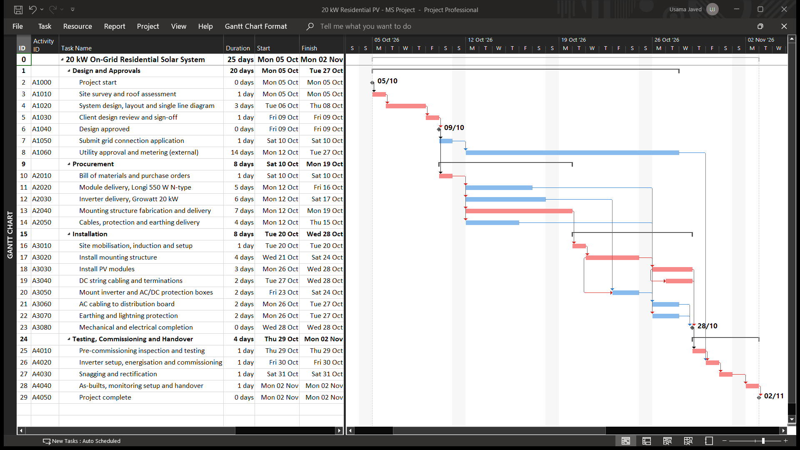
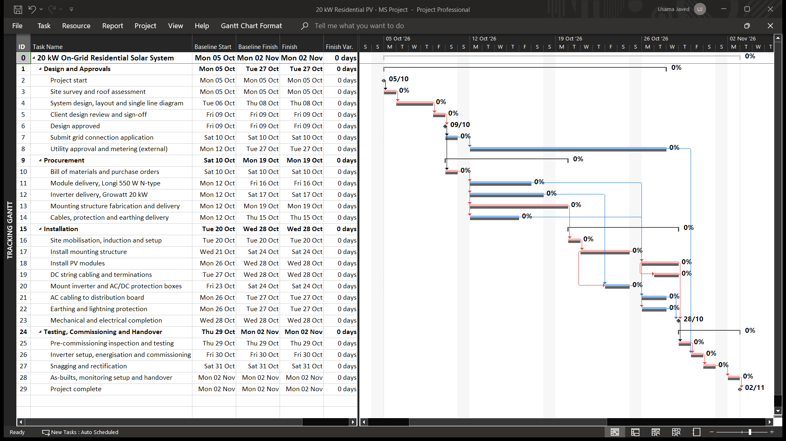

---

## 3. OpenSolar Rooftop Design and Customer Proposal

Drawn in OpenSolar on the 11.7 m by 17.7 m roof in F-11/2, Islamabad:
- **Layout**: 36 LONGi 550 W modules (19.8 kWp) in 6 rows of 6 on single-tilt frames at 20 deg, turned to **148 deg** to line up with the house rather than due south, with **2.80 m row pitch** and clear walkways around the stair room.
- **Stringing**: two strings of 18 into one Growatt MID 20KTL3-X (DC/AC ratio 0.99); the three north west rows make one string and the three south east rows the other.
- **Performance**: NREL System Advisor Model gives **27,283 kWh a year** (**1,378 kWh/kWp**) at 13.8% system losses, covering **114%** of a 24,000 kWh annual household load. Because the roof is drawn on flat satellite imagery, OpenSolar leaves shading out.

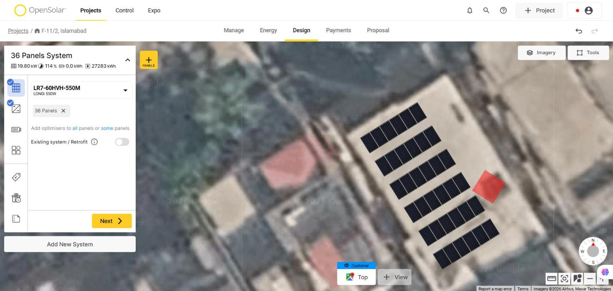
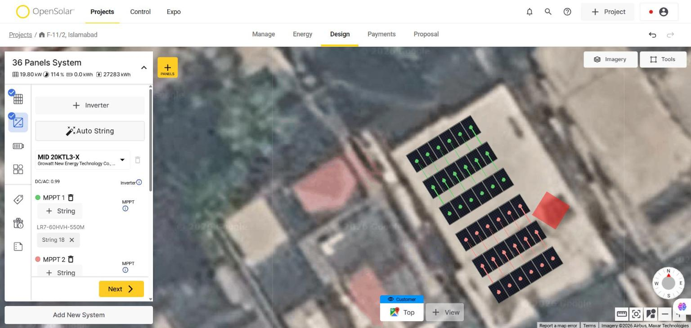

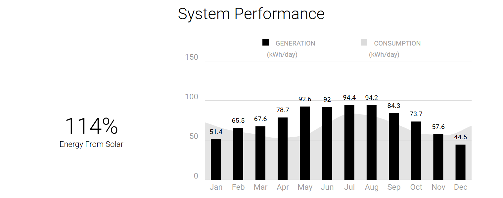

---

## 4. SketchUp 3D Model and Python Shading Check (`sketchup-and-shading/`)

Modelled in 3D in SketchUp (`sketchup-and-shading/20-kW-rooftop-pv-islamabad.skp`) to the same dimensions as the OpenSolar layout:
- Two storey brick house with a 11.7 m by 17.7 m roof, 0.9 m parapet, 2.5 m square stair room on the north east side, windows, entrance porch and boundary wall.
- Array of 6.90 m by 15.87 m, 2.80 m row pitch, about 0.9 m in from the roof edge at each end and 0.80 m on the south west side, and a 0.75 m walkway past the stair room. Geo-located at `33.68934 N, 72.99206 E` with true north set.
- **Ray-traced shading study (`sketchup-and-shading/shading_check.py`)**: traces rays from 30 sample points on every module (1,080 points total) to the sun every 7th day of the year. About **3.8% of clear-sky direct sun** is lost over the year: 1.6 points to the rows in front (mostly on winter mornings), 1.4 to the stair room and 0.85 to the parapet. The module beside the stair room loses 17.5%. On 21 December the rows clear each other from 11:55 until sunset (2 cm margin at noon).

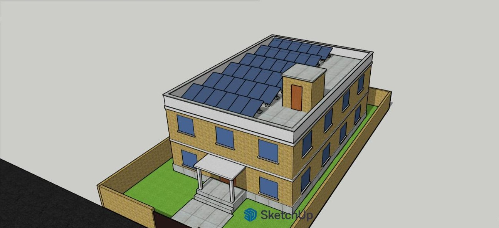
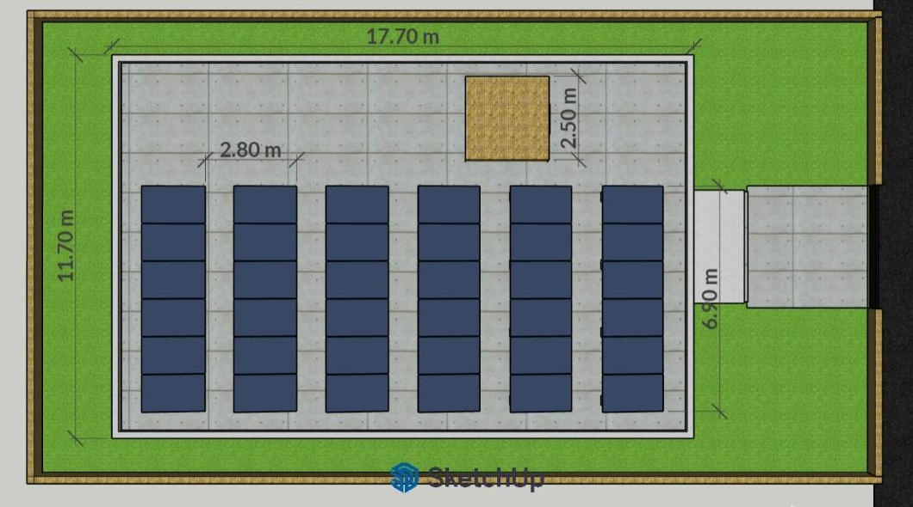
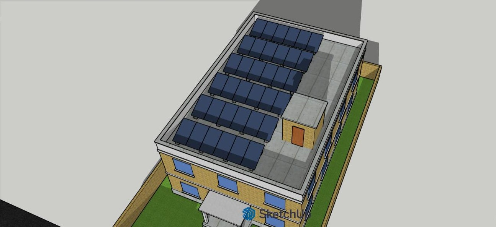
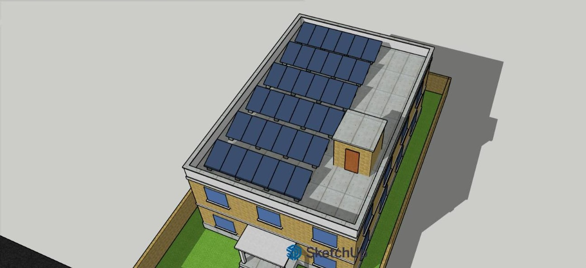
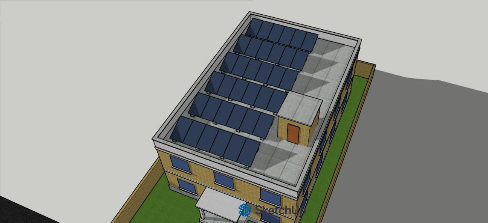
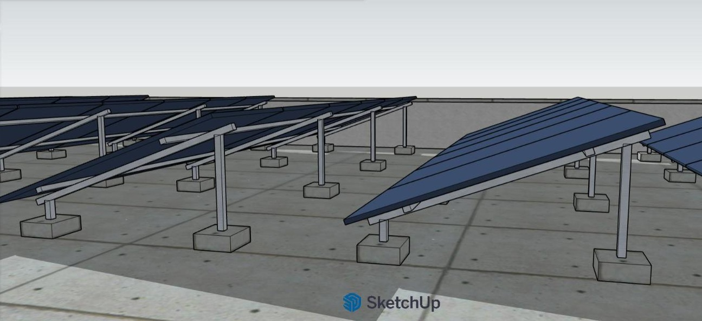
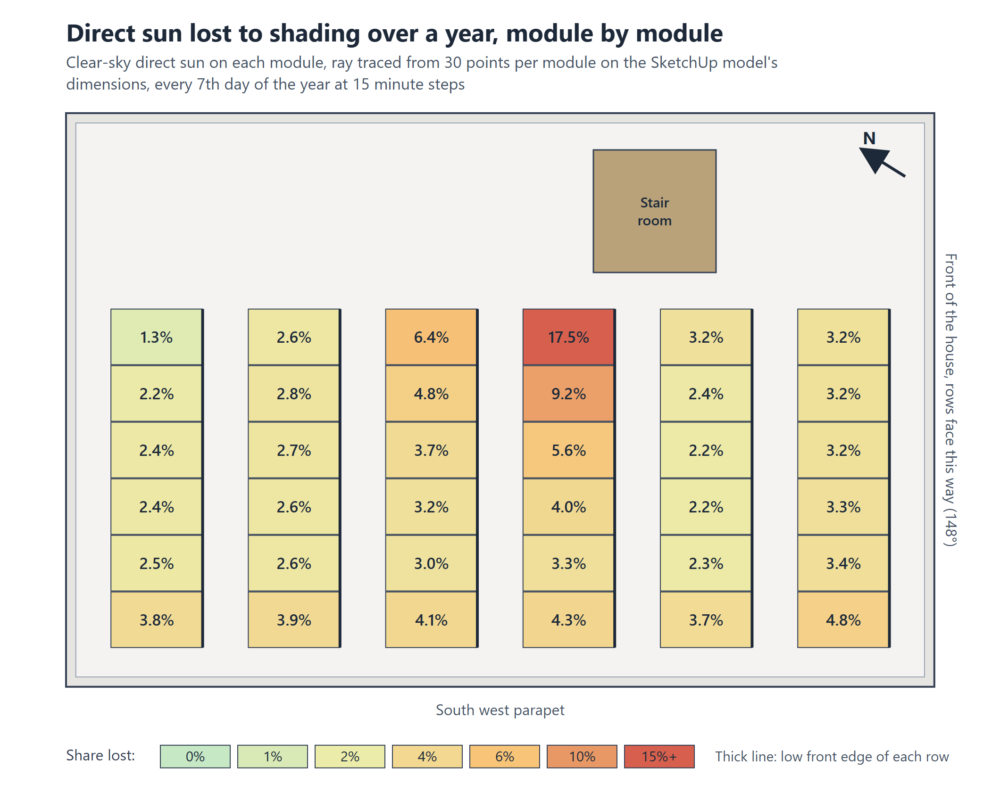

---

## Related Solar PV Engineering, Planning and Analytics Projects by Usama Javed

- **Portfolio Website**: [usamajaved.ie](https://usamajaved.ie) ([Project Planner / Scheduler](https://usamajaved.ie/roles/planning) · [Solar Project / Technical Engineer](https://usamajaved.ie/roles/project-engineering) · [Site Supervisor / Field Delivery](https://usamajaved.ie/roles/site-delivery) · [Energy / Reporting Analyst](https://usamajaved.ie/roles/energy-analytics))
- **[80kw-pv-bess-autocad-dispatch](https://github.com/usamajaved1305/80kw-pv-bess-autocad-dispatch)**: 80 kW commercial rooftop PV and 63 kWh FoxESS battery storage in AutoCAD 2027 (A1 sheets PV-01, PV-03, PV-04) and 8,760-hour Python dispatch simulation
- **[115kwp-solar-energy-yield-python](https://github.com/usamajaved1305/115kwp-solar-energy-yield-python)**: 115 kWp commercial rooftop PV energy yield model in Python (Jupyter, pandas, matplotlib, PVGIS ERA5) and HelioScope simulation
- **[115kwp-solar-bom-cost-procurement](https://github.com/usamajaved1305/115kwp-solar-bom-cost-procurement)**: 115 kWp commercial rooftop PV BOM, string voltage verification, procurement tracker and cost control in Excel, SQLite and Power BI
- **[20kw-rooftop-pv-schedule-and-shading](https://github.com/usamajaved1305/20kw-rooftop-pv-schedule-and-shading)**: 20 kW residential rooftop PV installation programme (Primavera P6 and MS Project), OpenSolar proposal and SketchUp 3D ray-traced shading check
- **GitHub Profile**: [github.com/usamajaved1305](https://github.com/usamajaved1305) · **LinkedIn**: [linkedin.com/in/usama-javed-553b8624b](https://www.linkedin.com/in/usama-javed-553b8624b)
